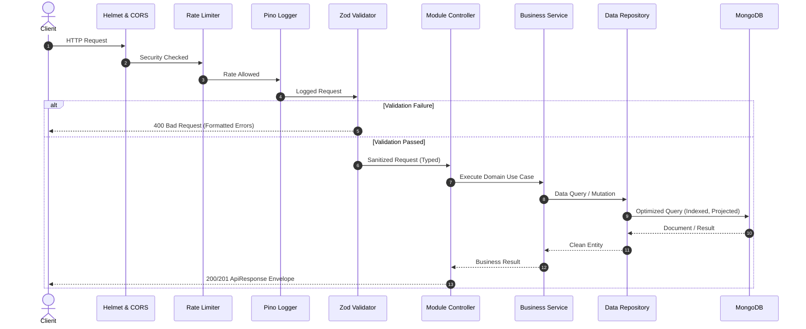

# VibeArena System Architecture

This document defines the architectural standards, patterns, and design principles powering the **VibeArena** backend.

---

## 1. Core Architectural Principles

- **Clarity > Complexity**: Code readability and explicit intent take precedence over clever abstractions.
- **Modular > Monolithic**: Features are self-contained domains with their own controllers, services, repositories, and models.
- **Decoupled Persistence (Repository Pattern)**: Business services never perform direct database queries. Database operations are strictly encapsulated in repositories.
- **Centralized Validation**: Clients are never trusted. All incoming payloads (body, query, params) must pass through schema validation before reaching business services.
- **Zero Business Logic in Controllers**: Controllers handle HTTP protocol concerns exclusively (extracting params, invoking services, returning standard response codes).
- **Fail-Safe & Graceful Lifecycle**: Structured process teardown handling connection draining, database disconnects, and unhandled exceptions.

---

## 2. Directory Structure Breakdown

```
vibeareana/
├── .env.example
├── .gitignore
├── ARCHITECTURE.md
├── README.md
├── package.json
├── tsconfig.json
└── src/
    ├── app.ts                  # Express application setup, global middleware pipeline
    ├── server.ts               # HTTP & Socket server bootstrap, DB init, graceful shutdown
    │
    ├── config/                 # Environment configuration
    │   └── index.ts            # Typed environment validation via Zod
    │
    ├── constants/              # Global constants & enums
    │   ├── http-status.ts      # HTTP status code enums
    │   ├── socket-events.ts    # Real-time WebSocket event contract
    │   └── index.ts
    │
    ├── database/               # Database connectivity & pooling
    │   └── index.ts            # Singleton Mongoose connection manager with lifecycle events
    │
    ├── errors/                 # Centralized exception hierarchy
    │   ├── app-error.ts        # Base AppError class
    │   ├── bad-request.error.ts
    │   ├── not-found.error.ts
    │   ├── unauthorized.error.ts
    │   └── index.ts
    │
    ├── middlewares/            # Cross-cutting HTTP middlewares
    │   ├── error.middleware.ts # Global error interceptor & response transformer
    │   ├── validate.middleware.ts # Zod schema validation interceptor
    │   ├── rate-limit.middleware.ts # DDoS & brute-force mitigation
    │   └── index.ts
    │
    ├── utils/                  # Shared utilities
    │   ├── logger.ts           # High-performance Pino logger instance
    │   ├── api-response.ts     # Standardized JSON response envelope
    │   └── index.ts
    │
    └── modules/                # Feature modules (Domain-Driven)
        │
        ├── auth/               # Authentication & Authorization
        │   ├── auth.controller.ts
        │   ├── auth.service.ts
        │   ├── auth.routes.ts
        │   ├── auth.validation.ts
        │   └── index.ts
        │
        ├── user/               # User Identity & Presence
        │   ├── user.model.ts
        │   ├── user.repository.ts
        │   ├── user.service.ts
        │   ├── user.controller.ts
        │   ├── user.routes.ts
        │   ├── user.validation.ts
        │   └── index.ts
        │
        ├── chat/               # Conversations, Rooms & Group Management
        │   ├── chat.model.ts
        │   ├── chat.repository.ts
        │   ├── chat.service.ts
        │   ├── chat.controller.ts
        │   ├── chat.routes.ts
        │   ├── chat.validation.ts
        │   └── index.ts
        │
        ├── message/            # Chat Messages, History & Receipts
        │   ├── message.model.ts
        │   ├── message.repository.ts
        │   ├── message.service.ts
        │   ├── message.controller.ts
        │   ├── message.routes.ts
        │   ├── message.validation.ts
        │   └── index.ts
        │
        └── socket/             # Real-Time Event Gateway
            ├── socket.server.ts # WebSocket gateway initialization
            └── socket.types.ts  # Typed payload definitions
```

---

## 3. Request Lifecycle



---

## 4. Real-Time Chat Scalability

### 4.1. Message Pipeline
1. **Event Ingestion**: Real-time messages are dispatched over WebSockets via typed socket events (`chat:send_message`).
2. **Immediate Broadcast**: The gateway broadcasts the message payload to the dedicated room channel (`chat:<chatId>`).
3. **Asynchronous Persistence**: Messages are persisted to MongoDB via the `MessageRepository` without blocking WebSocket event propagation.
4. **Read Receipts**: Delta updates to `lastReadAt` / read receipts use indexed bulk writes to avoid database thrashing.

### 4.2. Horizontal Scaling (Multi-Node Target)
- In single-node environments, internal memory handles room subscribers.
- For multi-instance horizontal scaling, the socket layer bridges with Redis Pub/Sub (Socket.io Redis adapter or native Redis client), allowing any node in the cluster to broadcast to users connected to other nodes.

---

## 5. Database & Performance Standards

1. **Compound Indexing**:
   - `Chat`: `{ participants: 1, updatedAt: -1 }`
   - `Message`: `{ chatId: 1, createdAt: -1 }` (supports instant reverse cursor pagination)
2. **Cursor-Based Pagination**:
   - Traditional offset/skip queries (`skip(1000)`) degrade at $O(N)$ depth.
   - Message history utilizes cursor-based pagination via `{ createdAt: { $lt: cursor } }`, yielding constant $O(1)$ query times.
3. **Lean & Projected Queries**:
   - High-throughput read operations leverage `.lean()` to bypass Mongoose hydration overhead.
   - Explicit field projection (`.select('name avatar status')`) avoids hauling redundant document fields across the wire.
4. **Connection Pooling**:
   - Configured via `maxPoolSize: 20` and `minPoolSize: 5` to handle concurrent traffic spikes without connection dropouts.

---

## 6. Error Handling & Standard Responses

All API responses follow a strict envelope format:

### Success Response
```json
{
  "success": true,
  "statusCode": 200,
  "message": "Operation successful",
  "data": {}
}
```

### Error Response
```json
{
  "success": false,
  "statusCode": 400,
  "message": "Validation failed",
  "errors": [
    {
      "field": "email",
      "message": "Invalid email address"
    }
  ]
}
```
